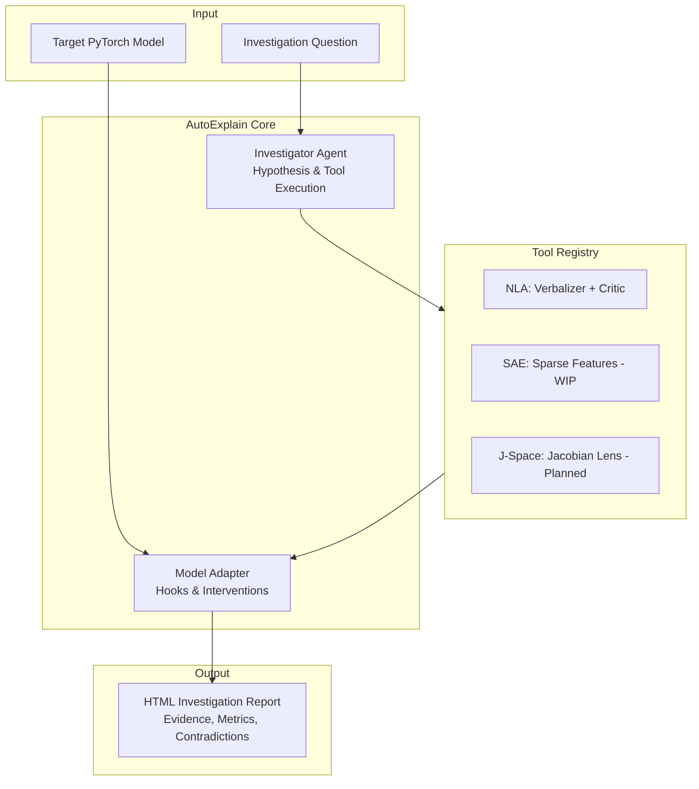

# AutoExplain

AutoExplain is a Python library and CLI for inspecting internal representations in deep neural networks and running causal intervention tests.

Most interpretability papers release standalone code written for a single model checkpoint. AutoExplain wraps these methods behind a shared experiment interface so you can run multiple interpretability tools on the same layer, compare their outputs, and test whether discovered features actually change model behavior under intervention.

## Current Status

The library is in early development. Currently implemented:

- **Model Adapter (`autoexplain.core.adapter`)**: PyTorch forward and backward hooks for activation caching and interventions (clamping, zeroing, and vector steering).
- **Natural Language Autoencoders (`autoexplain.nla`)**: Converts residual-stream activations into natural-language descriptions and measures reconstruction fidelity. Implements the Actor (Activation Verbalizer via `inputs_embeds`) and Critic (Activation Reconstructor via linear value head) architecture from Anthropic's Transformer Circuits research, with support for pretrained checkpoints from `kitft/nla-models` (Qwen 2.5, Gemma 3, Llama 3.3).
- **Automated Investigation Loop (`autoexplain.Investigator`)**: Runs diagnostic tools against a target model, evaluates findings against random-vector controls, and writes an HTML report.
- **CLI (`autoexplain`)**: Run tool inspections and investigations directly from the terminal.

Planned tools:
- Sparse Autoencoders (SAE) via SAE Lens integration
- Jacobian Lens (J-Space) layerwise readouts
- Block-Sparse Featurizers for vision models
- Manifold steering along learned representation geometry

## Installation

```bash
git clone https://github.com/phamtrongthang123/AutoExplain.git
cd AutoExplain
pip install -e ".[dev]"
```

## Quick Start

### Python API

```python
from autoexplain import Investigator

# Load a model and run an investigation
agent = Investigator(model="gpt2")
report = agent.investigate(
    question="What does layer 8 represent?",
    tools=["nla"],
    max_experiments=5,
)

# Save the report
report.save_html("investigation_report.html")
```

### CLI

```bash
# List available tools
autoexplain list-tools

# Run an investigation
autoexplain investigate --model gpt2 --question "What does layer 8 represent?" --tools nla --output report.html
```

## How It Works

When you run an investigation, AutoExplain executes four steps:

1. **Activation capture**: Attaches hooks to the target layer and records activation vectors during a forward pass. By default, the tool selects layers roughly two-thirds through the model, where semantic representations are typically densest.
2. **Tool evaluation**: Passes the captured activations to each requested diagnostic tool. For example, the NLA tool normalizes the vector to the calibrated L2 scale, injects it into the prompt embedding, generates an explanation, and reconstructs the vector to calculate reconstruction error.
3. **Causal controls**: Compares the tool results against baseline controls, such as random Gaussian vectors. If an explanation reconstructs a random noise vector just as well as the actual activation, the report flags the explanation as ungrounded.
4. **Report export**: Synthesizes the evidence, logged contradictions, and test metrics into a standalone HTML file.

## Architecture



## Running Tests

```bash
pytest -v
```

## License

MIT
